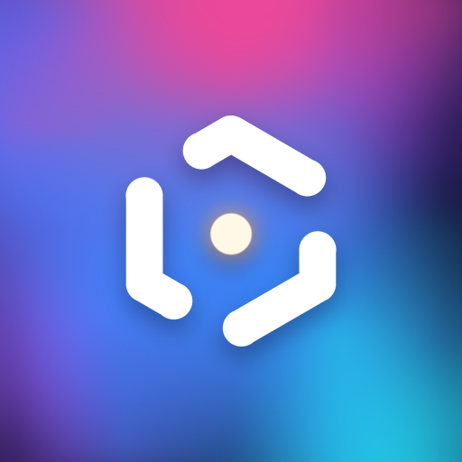

<p align="center">
  
</p>

<h1 align="center">Lume</h1>

<p align="center">
  <a href="https://github.com/marioondc9426/Lume/releases/latest"></a>
  <a href="https://github.com/marioondc9426/Lume/stargazers"></a>
  <a href="https://github.com/marioondc9426/Lume/commits/main"></a>
  <a href="https://github.com/marioondc9426/Lume/issues"></a>
  
  
  
</p>

<p align="center">
  A chat for AI models that runs on your own PC (and, in beta, on your iPhone).<br>
  Local models first, cloud models when you want them. No account with Lume, no subscription.
</p>

---

## What is it

Lume is a chat app (Windows window + a small local server) built around [Ollama](https://ollama.com). It started as a way to use AI without paying any cloud, so everything works with free local models. Cloud providers are optional extras you turn on by pasting a key.

The code is fully open source: read it, change it, break it.

## Features

**Chat**
- Several chats at the same time. Switch chats while an answer is still being written.
- Queue your next messages while the AI is busy, delete a message before the AI sees it, edit or regenerate any answer (versions `‹ 1/3 ›`).
- "Thinking" blocks for reasoning models, including several thinking rounds in one answer, and support for models that put `<think>` inside the text.
- Web search on demand (Exa if you have a key, otherwise DuckDuckGo) with source cards.
- Attach images, PDF, Word, Excel, PowerPoint and OpenDocument files, or paste them. If a file has an unsupported extension but is plain text, Lume offers to treat it as `.txt`.
- Memory: Lume can suggest facts to remember ("Lembrar?") and you can delete any of them.
- Live tokens/s, VRAM and GPU panel, context bar, English and Portuguese interface.
- A modern interface with a collapsible sidebar and a start screen, plus themes (DeepSeek, Kimi, Claude, Ollama, Gemini, Perplexity styles) that change font, corners, layout and background, not just colors. You can build your own in the theme editor, or switch back to the classic interface in Settings.

**Accounts and sync**
- Accounts without passwords (`accounts/<name>/` folders): separate chats and memories per person or per device. Export or import them as a `.json` file.
- Optional PC sync for the iPhone app. Devices you mark as trusted (`trusted_devices.json`) get your chats, memories and API keys back from the PC.

**Costs**
- Pollinations pricing is shown per 1,000 tokens; while you type, a small estimate shows the tokens of your message and its likely cost in pollen. The stats page tracks real spending per model and per day.
- A **Pollinations menu** (Settings) lists the whole catalog with live health and filters the site does not have: hide 0% models, hide paid ones (keep free and quest only).

**Code tab**
- The AI can list/read/write files and run commands in a folder you choose. Writing and running **always ask your permission** in a popup.
- Code blocks have a **Run** button (Python, JavaScript, PowerShell, BAT, Bash) that turns into **Stop** while the program runs.
- Up to 5 tool calls in one step, native tool calling where the provider supports it.
- Optional **auto-allow** toggle (Settings): skips the popup for normal commands but always blocks dangerous ones (`diskpart`, `format`, deleting system or user folders, registry, accounts, services, shutdown, download-and-run). It is a filter, not a guarantee.

**Models**
- Model manager for Ollama: pull, update, delete, optional auto-update.
- Models are grouped by family (`Gemma 3 e 4`, `Qwen 2.5, 3 e 3.5`...) with a parameter picker and a provider picker.
- Colors: **blue** = local, **gray** = free cloud, **yellow** = paid.
- If a provider fails, Lume can retry with the next cheapest one.

**Phone and friends**
- Use it from your phone on the same Wi-Fi, or from anywhere through Cloudflare Tunnel or Tailscale Funnel (password protected).
- Invite friends with their own limits (models, messages per day, features).
- Optional: run small models directly on the phone (WebLLM / WebGPU).

## Providers

<!-- Maintainers: this table only shows the main providers. New ones go in CHANGELOG.md and in the "many others" row, not here. -->

| Provider | Needs | Notes |
|---|---|---|
| **Ollama (local)** | Ollama installed | Free, private, runs on your GPU/CPU |
| **Ollama Cloud** | Ollama account | One of the best, but doesn't include a wide variety of models.|
| **OpenRouter** | API key | Lume only lists some free models |
| **Cloudflare Workers AI** | API token + Account ID | 10,000 free neurons per day, with a usage monitor |
| **Pollinations** | API key | Paid models use "pollen" (you earn some for free with quests). Shows your balance and the cost of each message |
| **Groq** | API key | bad |
| **...and many others** | API key | More free providers are added all the time (see [CHANGELOG.md](CHANGELOG.md)). Lume only lists free models, and models that stop answering disappear from the list until they work again |

Add as many keys as you want, plus backup keys: if the main one runs out, Lume tries the next one.

Keys are stored only on your PC, in `config.json`. They are never uploaded anywhere by Lume.

## Install

**Easiest (Windows):** download `Lume.exe` from the [latest release](https://github.com/marioondc9426/Lume/releases/latest) and run it. It updates itself when a new release is published.

**From source:**

```bash
git clone https://github.com/marioondc9426/Lume.git
cd Lume
pip install -r requirements.txt
python app.py        # or double-click run.bat
```

You also need [Ollama](https://ollama.com/download) for local models. Lume starts it for you.

Your data (chats, memory, settings) lives in `%LOCALAPPDATA%\Lume` when you use the `.exe`, and in the project folder when you run from source.

## iPhone app (beta)

The same interface inside an app, with a JavaScript port of the server: it runs **without a PC**, uses the cloud models, and can optionally talk to the Ollama on your PC. It updates itself when you open it (and warns you if it can't).

The `.ipa` is **unsigned**: download `Lume-unsigned.ipa` from the [`latest-ios` release](https://github.com/marioondc9426/Lume/releases/tag/latest-ios) and sign it with your own certificate (Sideloadly, AltStore...). More details in [ios/README.md](ios/README.md). Not everything from the PC exists there (no Code tab, no running code, no Cloudflare).

## Build the .exe yourself

```bash
pip install -r requirements-build.txt
python build_exe.py            # creates dist/Lume.exe
```

Run `setup-hooks.bat` once if you want the `.exe` to rebuild automatically after every commit. Pushing a tag like `v2.2` makes GitHub Actions build and publish the release.

## Safety notes

- The Code tab runs real commands on your PC. Read the permission popup before you click Allow.
- "Run" on a code block runs it with your user, inside the `code_runs` folder. Only run what you understand.
- Remote access (phone, friends) is off until you turn it on, and needs a password. The Code tab (files and commands) is refused for remote devices unless you explicitly allow it in the server settings.
- Messages sent to a cloud provider leave your PC and are handled by that provider's rules, not Lume's. Use local models for private things.

## Status

The PC app is Windows only for now. Linux and macOS builds do not exist yet, and I will probably not make them unless people ask. The iPhone app is a beta: it is the least tested part.

The full list of changes is in [CHANGELOG.md](CHANGELOG.md).

and most importantly: **100% free**.